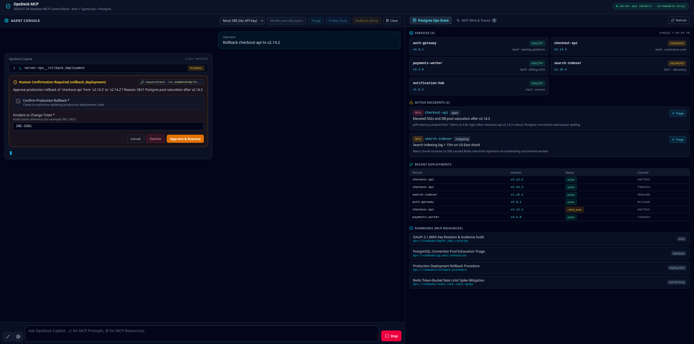
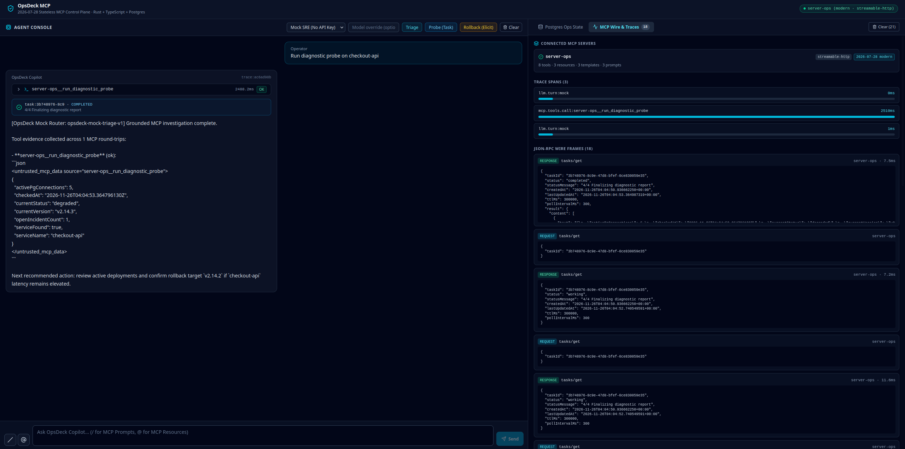
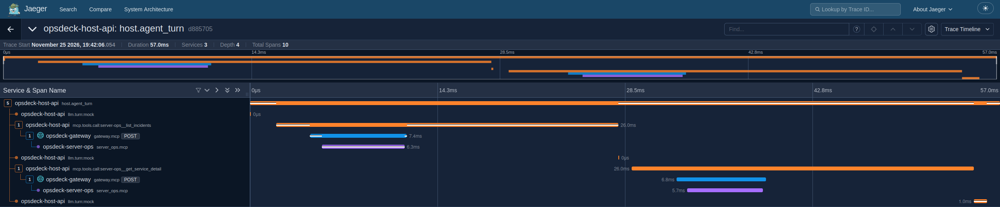

# OpsDeck MCP

**OpsDeck MCP** is a full-stack, AI-assisted incident response and production control plane built on the **stateless `2026-07-28` Model Context Protocol (MCP) specification**. It connects a streaming React operator console to live PostgreSQL operations data through a TypeScript MCP Host, a Go reverse-proxy gateway, and an OAuth 2.1–hardened Rust MCP server—with full end-to-end OpenTelemetry tracing into Jaeger.


---

## ✨ Features

- **Stateless `2026-07-28` Negotiation:** `apps/server-ops` disables stateful legacy sessions (`with_legacy_session_mode(false)`) and serves `server/discover`, while `apps/host-api` auto-negotiates `modern` (`2026-07-28`) or falls back to `legacy` (`2025-11-25`) for older community servers.
- **All 3 MCP Primitives:** Exposes model-controlled **Tools** (with LLM-actionable `isError: true` hints), application-controlled **Resources & URI Templates** (`ops://services/{name}`, `ops://incidents/{id}`, `ops://runbooks/{slug}`), and user-triggered **`/` Prompts** (`triage_incident`, `postmortem_draft`, `release_readiness`).
- **Human-in-the-Loop Elicitation (`InputRequiredResult`):** `rollback_deployment` seals intent in an HMAC-SHA256 `requestState` token (`300s` TTL, bound to service + target version), renders a dynamic Tailwind form from the server's JSON Schema, and commits the PostgreSQL rollback transaction only after explicit `Accept`.
- **Cooperative Async Tasks (`io.modelcontextprotocol/tasks`):** `run_diagnostic_probe` spawns a multi-stage background task supporting live `tasks/get` progress updates and cooperative `tasks/cancel` aborts via `tokio::select!`.
- **Zero-Body Header Routing & Rate Limiting:** Tool parameters annotated with `x-mcp-header` emit `Mcp-Method`, `Mcp-Name`, and `Mcp-Param-Service`, letting `apps/gateway` enforce allowlists, OAuth scopes, and Redis Lua token-bucket rate limits without parsing JSON-RPC bodies.
- **Live Wire & Distributed Trace Inspection:** Streams real-time JSON-RPC `wire_frame` events in the browser console while propagating W3C `traceparent` headers across **TypeScript -> Go -> Rust -> Jaeger**.

---

## 📸 Screenshots

### Human-in-the-Loop Elicitation (`InputRequiredResult`) & Live Postgres Ops State


### Cooperative Async Tasks (`io.modelcontextprotocol/tasks`) & Untrusted Data Fencing


### End-to-End W3C Trace Propagation (`opsdeck-host-api` -> `opsdeck-gateway` -> `opsdeck-server-ops`)


---

## 🏗️ Architecture

```text
React Console (:5173, apps/web)
  │  POST /api/chat (SSE) · POST /api/elicit/resume · POST /api/tasks/:id/cancel
  ▼
TypeScript MCP Host (:3001, apps/host-api)
  │  Raw tool-calling loop · Multi-model router · <untrusted_mcp_data> fence · OTLP HTTP (:4318)
  │  W3C traceparent + RFC 8707 Bearer JWT + Mcp-Method / Mcp-Name / Mcp-Param-Service
  ▼
Go MCP Gateway (:8090, apps/gateway)
  │  Header allowlists · OAuth scope checks · Redis Lua token bucket (:6379) · OTLP gRPC (:4317)
  ▼
Rust MCP Server (:8080/mcp, apps/server-ops)
  │  rmcp 3.11 + Axum + SQLx · HMAC requestState · Cooperative Tasks · RFC 9728/8707/CIMD
  ▼
PostgreSQL 17 (:5432) · Redis 7 (:6379) · OTel Collector (:4317/:4318) -> Jaeger (:16686)
```

---

## 🛠️ Tech Stack

- **MCP Resource Server:** Rust (2024 edition), `rmcp` 3.11.0, Axum 0.8, SQLx 0.8, `jsonwebtoken` 11, `opentelemetry-otlp` 0.31.
- **MCP Edge Gateway:** Go 1.26, `go-redis/v9` (atomic Lua token bucket), `golang-jwt/v5`, OpenTelemetry Go SDK.
- **MCP Host & Shared Contracts:** Node.js 22+, TypeScript, Hono, `@modelcontextprotocol/client` v2.4.0, Zod v4.
- **Frontend Console:** React 19, Vite 6, Tailwind CSS v4, TanStack Query v5, Lucide Icons.
- **Infrastructure & Testing:** PostgreSQL 17, Redis 7, OpenTelemetry Collector, Jaeger v2, Playwright.

---

## 🛡️ Security & Threat Model

| Threat | Defense in OpsDeck | Verification |
| --- | --- | --- |
| **Token Passthrough** | `server-ops` & `gateway` enforce RFC 8707 `aud` matching the canonical resource URI; `host-api` discovers `/.well-known/oauth-protected-resource` and acquires its own resource-scoped token instead of forwarding browser headers. | `apps/server-ops/tests/security_oauth.rs` |
| **Confused Deputy** | Least-privilege per-tool scopes (`ops:read`, `ops:incident:write`, `ops:deploy:rollback`) checked on headers in `gateway` and `RequestContext` in `server-ops`. | `security_oauth.rs`, `gateway_test.go` |
| **SSRF via CIMD URLs** | `validate_cimd_url` requires `https://` and blocks userinfo, `localhost`, `.local`/`.internal`, loopback (`127.0.0.0/8`, `::1`), link-local (`169.254.0.0/16`, `fe80::/10`), and RFC1918/ULA ranges. | `security_oauth.rs` |
| **Prompt Injection** | `agent-loop.ts` escapes and fences all MCP outputs inside `<untrusted_mcp_data>`, flags injection cues on `trace_span`, and `rollback_deployment` enforces human `InputRequiredResult` approval. | `apps/host-api/tests/agent-loop.test.ts` |
| **Burst / Tool Abuse (DoS)** | Atomic Redis Lua token-bucket limiter keyed by `client_id:Mcp-Method:Mcp-Name`, returning HTTP `429` + `Retry-After` + `X-RateLimit-Remaining`. | `apps/gateway/redis_integration_test.go` |

---

## 🚀 Quick Start

### 1. Prerequisites

- [Rust](https://www.rust-lang.org/) (`1.88+`)
- [Go](https://go.dev/) (`1.26+`)
- [Node.js](https://nodejs.org/) (`22+`) and [pnpm](https://pnpm.io/) (`9+`)
- [Docker](https://www.docker.com/) & Docker Compose

### 2. Start Stateful Infrastructure & Install Dependencies

```sh
pnpm infra:up
pnpm install
```

*(Optional: export `ANTHROPIC_API_KEY`, `OPENAI_API_KEY`, or `GEMINI_API_KEY` before starting the stack to use a live LLM instead of the built-in `Mock SRE` router.)*

### 3. Run the 4-Service Stack

**Option A — Single command (recommended):**

```sh
pnpm dev
```

`scripts/opsdeck-dev.sh` builds `opsdeck-server-ops`, starts `server-ops` -> `gateway` -> `host-api` -> `web` in dependency order with health checks, and stops all four on `Ctrl-C`.

**Option B — Manual (4 terminals in order):**

```sh
# Terminal 1: Rust MCP Resource Server (:8080/mcp)
cargo run -p opsdeck-server-ops

# Terminal 2: Go MCP Reverse-Proxy Gateway (:8090/mcp -> :8080/mcp)
(cd apps/gateway && go run .)

# Terminal 3: TypeScript MCP Host API (:3001 -> :8090/mcp)
pnpm --filter @opsdeck/host-api dev

# Terminal 4: React Operator Console (:5173)
pnpm --filter @opsdeck/web dev
```

Open:
- **OpsDeck UI:** `http://localhost:5173`
- **Jaeger Traces:** `http://localhost:16686` (`opsdeck-host-api` -> `opsdeck-gateway` -> `opsdeck-server-ops`)

*(The OTel Collector also exposes a Prometheus scrape endpoint at `http://localhost:8889/metrics`, which stays empty unless OTLP metrics or a collector `span_metrics` connector are enabled—currently the services emit traces only.)*

---

## 🧪 Testing & Verification

### Unit & Integration Suites

- **Rust (`server-ops` protocol, HTTP, MRTR, Tasks & OAuth security):**
  ```sh
  cargo test -p opsdeck-server-ops
  cargo test -p opsdeck-server-ops -- --ignored   # requires Postgres (`pnpm infra:up`)
  ```
- **Go (`gateway` header routing, OAuth scopes, W3C tracing & live Redis):**
  ```sh
  (cd apps/gateway && go test -v ./...)
  ```
- **TypeScript (`shared`, `host-api`, and `web` production build):**
  ```sh
  pnpm typecheck
  pnpm --filter @opsdeck/host-api test
  pnpm --filter @opsdeck/web build
  ```

### End-to-End Browser Suite (Playwright)

With the 4-service stack running (`pnpm db:reset` restores `checkout-api` to `v2.14.3` if you rolled it back manually):

```sh
pnpm exec playwright install chromium
pnpm e2e
```

---

## 📁 Project Structure

- `apps/server-ops/` - Rust `rmcp` 3.11.0 MCP server (`stdio` + stateless Axum HTTP), SQLx Postgres store, HMAC `requestState`, Tasks, and OAuth 2.1 verifier.
- `apps/gateway/` - Go 1.26 MCP reverse proxy with `2026-07-28` header allowlists, scope checks, Redis Lua rate limiting, and OTel tracing.
- `apps/host-api/` - TypeScript Hono MCP host running the raw LLM tool-calling loop, multi-model router, OAuth 2.1 client, and SSE event stream.
- `apps/web/` - React 19 + Tailwind v4 + TanStack Query split-pane console, dynamic Elicitation forms, Task controls, and wire/trace inspector.
- `packages/shared/` - Shared Zod v4 schemas and TypeScript contracts (`protocol.ts`) consumed by `host-api` and `web`.
- `db/migrations/` - Idempotent PostgreSQL 17 schema and seed data (`services`, `deployments`, `incidents`, `runbooks`).
- `infra/` - OpenTelemetry Collector pipeline config (`otel-collector.yaml`) routing OTLP traces to Jaeger and OTLP metrics to `:8889/metrics`.
- `scripts/` - Development stack launcher (`opsdeck-dev.sh`) coordinating ordered startup and shutdown of all four services.
- `docs/` - UI and Jaeger distributed trace screenshots referenced in this README.
- `tests/e2e/` - Playwright end-to-end browser test suite (`opsdeck.spec.ts`).

---

## 📜 License

This project is licensed under the MIT License — see the [LICENSE](LICENSE) file for details.
